<p align="center">
  
</p>

<p align="center">
  <strong>Install Minecraft modpacks, mods, resource packs and shaders for the official launcher, from the command line.</strong>
</p>

<p align="center">
  <a href="https://github.com/ModsmithMC/modsmith/actions/workflows/ci.yml"></a>
  <a href="https://github.com/ModsmithMC/modsmith/releases"></a>
  <a href="https://www.python.org/downloads/"></a>
  
  <a href="LICENSE"></a>
</p>

<p align="center">
  <a href="https://modsmith.meneither.site/modsmith/">Documentation</a> · <strong>English</strong> · <a href="README_ZH.md">简体中文</a>
</p>

---

Modsmith prepares the game files and adds an installation to the official Minecraft launcher. It does not sign in or start the game: you choose the installation in the launcher and play.

<table>
  <tr>
    <td width="33%" valign="top">
      
      <p><strong>Modpacks in one command</strong></p>
      Install a pack from Modrinth, CurseForge or a file, with its mod loader and Minecraft.
    </td>
    <td width="33%" valign="top">
      
      <p><strong>Add what you like</strong></p>
      Add mods, resource packs and shaders, with the mods they need.
    </td>
    <td width="33%" valign="top">
      
      <p><strong>Updates that keep your changes</strong></p>
      Update a pack and what you added, and see what changed in each release.
    </td>
  </tr>
  <tr>
    <td valign="top">
      
      <p><strong>See before it happens</strong></p>
      Every change is shown first and waits for your yes. <code>--dry-run</code> only shows it.
    </td>
    <td valign="top">
      
      <p><strong>Ready in the launcher</strong></p>
      Each instance gets its own installation, with the pack's icon, in the official launcher.
    </td>
    <td valign="top">
      
      <p><strong>Bring your own</strong></p>
      Take over an installation you made in the launcher, and the mods you put in it.
    </td>
  </tr>
</table>

## Installation

Modsmith needs Python 3.12 or newer. Install it as a tool with [uv](https://docs.astral.sh/uv/), from a [release](https://github.com/ModsmithMC/modsmith/releases):

```bash
uv tool install https://github.com/ModsmithMC/modsmith/releases/download/v0.1.0/modsmith_app-0.1.0-py3-none-any.whl
```

Or with [pipx](https://pipx.pypa.io/):

```bash
pipx install https://github.com/ModsmithMC/modsmith/releases/download/v0.1.0/modsmith_app-0.1.0-py3-none-any.whl
```

Then check that it works:

```bash
modsmith --version
```

## Quick start

Find a modpack, install it, and play it from the official launcher:

```bash
modsmith search "fabulously optimized" --type modpack
modsmith install fabulously-optimized --name fo
```

Add a mod and a shader pack, then see what the instance holds:

```bash
modsmith add fo iris
modsmith add fo complementary-reimagined --type shader
modsmith show fo
```

Keep it up to date:

```bash
modsmith update fo
```

When you have only one instance, you can leave its name out.

## Commands

| Command | What it does |
| --- | --- |
| `install` | Install a modpack as a new instance |
| `create` | Start an empty instance, with or without a mod loader |
| `import` | Manage an installation you made in the official launcher |
| `list` | List your instances |
| `show` | List the mods, resource packs and shaders in an instance |
| `add` / `remove` | Add projects with what they need, or remove them |
| `enable` / `disable` | Turn files on or off without removing them |
| `pin` / `unpin` | Keep a project at its release, or let it update |
| `adopt` | Recognise files you put in an instance yourself |
| `update` | Update the pack and what you added |
| `move` / `delete` | Rename, move or delete an instance |
| `search` / `info` | Find projects and look at their releases |
| `loaders` | List a mod loader's versions |
| `config` | Show and change settings |

Every command explains itself with `--help`, examples included.

## Recipes

<details>
<summary><b>Use CurseForge</b></summary>

CurseForge needs an API key, which you can get for free from the [CurseForge console](https://console.curseforge.com). Save it once:

```bash
modsmith config set curseforge_api_key '<key>'
```

In PowerShell, keep the single quotes: `$` starts a variable inside double quotes. Then name CurseForge projects with `curseforge:`:

```bash
modsmith install curseforge:all-the-mods-9 --name atm9
modsmith add atm9 curseforge:jei
```

</details>

<details>
<summary><b>Install files that must be downloaded by hand</b></summary>

Some CurseForge authors block downloads by other tools. Modsmith lists those files with a link to each. Download them into one folder, then run the same command again:

```bash
modsmith install curseforge:all-the-mods-9 --name atm9 --from Downloads/atm9-files
```

</details>

<details>
<summary><b>Choose optional files</b></summary>

When a pack has optional files, Modsmith asks which ones you want. To decide on the command line instead:

```bash
modsmith install fabulously-optimized --optional shaders --optional zoom
modsmith install fabulously-optimized --all-optional
```

Your choice is remembered, and `update` keeps it.

</details>

<details>
<summary><b>Start from nothing</b></summary>

```bash
modsmith loaders fabric 1.21.1
modsmith create survival --minecraft 1.21.1 --loader fabric
modsmith add survival sodium lithium
```

Without `--loader-version`, the recommended version is used.

</details>

<details>
<summary><b>Take over an existing installation</b></summary>

Give the installation its own game directory in the official launcher, start it once, then:

```bash
modsmith import "My Fabric world"
```

Modsmith reads its Minecraft and loader versions, and recognises the mods in it so they can be updated.

</details>

<details>
<summary><b>Use it in scripts</b></summary>

Without a terminal, Modsmith never asks: it stops and tells you to add `--yes`. Deleting needs `--force` as well. For more than that, use the [Modsmith Python library](https://github.com/ModsmithMC/modsmith-python) directly.

</details>

## Where things go

| What | Where |
| --- | --- |
| Instances | Your user data folder, under `Modsmith/instances`. Change it with `modsmith config set instances_dir <folder>` |
| Settings | `config.toml` in your user config folder. `modsmith config path` prints it |
| Launcher installations | The official launcher's `launcher_profiles.json`, one per instance |

Set `MODSMITH_HOME` to keep everything in one folder instead.

## Built on

Modsmith is built on the [Modsmith Python library](https://github.com/ModsmithMC/modsmith-python), which does the real work: platforms, modpack formats, mod loaders and instances.

## License

[MIT](LICENSE)
