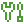

# Concepts

The ideas behind the commands. Read these to know why Modsmith does what it does.

:::{container} cards

-  [Instances and the launcher](instances.md)

  What an instance is, and how it appears in the official launcher.

-  [Where files come from](files.md)

  Pack files, added projects and your own files, and how each is treated.

-  [How changes stay safe](updates.md)

  Previews, downloads to the side, and the edits you keep.

:::

```{toctree}
:hidden:

instances
files
updates
```
